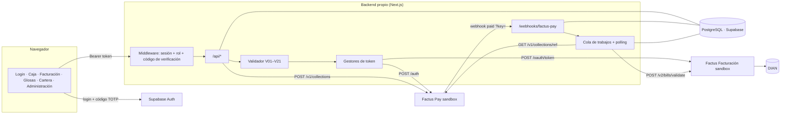

# SaludFactura

**Problema.** En las IPS el cobro en caja y la factura viven en sistemas distintos. Hay copagos cobrados que nunca se facturan, copagos que no se descuentan en la factura a la EPS y facturas mal armadas que terminan en glosas.

**Solución.** El copago se cobra con **Factus Pay** (QR Bre-B) y el pago confirmado dispara solo la factura **SS-Recaudo** en **Factus Facturación**. Al cerrar la atención se emite la **SS-CUFE** a la EPS descontando lo recaudado, y si la EPS glosa, sale la **nota crédito**. Todo queda unido por un mismo `reference_code`.

**Diferenciador.** Un motor de validación previa (reglas V01–V21) bloquea la factura mal armada antes de que llegue a la DIAN.

> Demo desplegada: `https://<completar>` · Video (2–3 min): `<completar>`

## Integrantes

| Integrante | Rol |
|---|---|
| Said Andrés Marín | Integración con Factus Pay y Factus Facturación, y despliegue |
| Juan Fernando Manrique | Backend, datos y validador |
| Jesús Gabriel De Hoyos | Frontend: login, Caja, Facturación, Glosas, Cartera y Administración |
| Jorge Isaac Piñeres | Pruebas y testeo |
| Freddy Fajardo | Pruebas y testeo |

## Arquitectura



El navegador solo habla con el backend propio: nunca ve un token de Factus ni llama a Factus directo. Las credenciales viven solo en variables de entorno del servidor. El flujo, los estados y el manejo de errores están en [`docs/integracion.md`](docs/integracion.md).

## Estructura

| Capa (rama) | Carpetas |
|---|---|
| Integración con Factus (`api`) | `lib/factus/` (clientes, tokens, simuladores), `lib/builders/` (SS-Recaudo, SS-CUFE, nota crédito), `app/webhooks/` |
| Backend (`backend`) | `app/api/`, `lib/services/`, `lib/validation/`, `lib/auth.ts`, `middleware.ts`, `lib/db.ts`, `db/`, `scripts/`, `tests/` |
| Frontend (`frontend`) | `app/login/`, `app/caja/`, `app/facturacion/`, `app/glosas/`, `app/cartera/`, `app/administracion/`, `app/components/` |

Todo entra a `main` por las ramas de cada capa; ver [`CONTRIBUTING.md`](CONTRIBUTING.md).

## Control de acceso

- **Login con Supabase Auth.** El rol sale de `app_metadata.role` (`admin` o `usuario`), que solo se asigna desde un entorno administrativo; `user_metadata` nunca da permisos.
- **Administración con verificación en dos pasos.** La cuenta de administrador pide, además de la contraseña, el código de 6 dígitos de una app autenticadora (Google Authenticator, Microsoft Authenticator o Authy). La primera vez se registra escaneando un QR.
- **El backend no confía en el navegador.** `middleware.ts` verifica en cada llamada a `/api/*` la firma del token con las llaves públicas del proyecto (ES256):
  - sin sesión o con un token inválido → **401**
  - cuenta sin rol asignado (por ejemplo, alguien que se registró solo) → **403**
  - administrador sin el código verificado (`aal1`) → **403**
  - si el control de acceso no está configurado → **503** (falla cerrado, nunca abierto)
- El webhook (`?key=` comparada en tiempo constante) y `/api/cron/tick` (`Bearer CRON_SECRET`) tienen su propia protección.

## Cómo correrlo

Requisitos: Node 20+, la base PostgreSQL del proyecto (Supabase) y, para el modo real, las credenciales sandbox de Factus.

```bash
npm install
cp .env.example .env     # completa los valores; .env está en .gitignore
npm run db:migrar        # crea las tablas y carga los datos ficticios (se puede repetir)
npm run db:demo          # deja listas las admisiones de respaldo para la demo
npm run dev              # http://localhost:3000
```

**En los portátiles del equipo deja `FACTUS_MOCK=true` y `FACTUS_PAY_MOCK=true`.** Factus Pay permite un solo token activo por usuario: si un portátil llama a `/auth`, revoca el token del servidor desplegado. En modo simulado, la pantalla de Caja muestra los botones "Simular pago exitoso / fallido".

## Pruebas

```bash
npm test                 # backend: validador, builders, clientes, servicios y control de acceso
npm run test:frontend    # reglas de acceso de la interfaz
npm run typecheck
```

Las pruebas de servicios corren sobre un **PostgreSQL real en memoria (PGlite)** con el mismo `db/schema.sql`. Cubren el webhook (llave inválida, duplicados, monto distinto, webhook falso), los estados de la admisión, el polling de respaldo y el pago rechazado, sin tocar Supabase ni Factus.

## Despliegue (Vercel)

1. Importar el repositorio con **`main`** como rama de producción.
2. Cargar las variables de `.env.example`, con:
   - `FACTUS_MOCK=false` y `FACTUS_PAY_MOCK=false`
   - `DATABASE_URL` del *Transaction pooler* de Supabase (puerto **6543**)
   - `NEXT_PUBLIC_SUPABASE_URL` y `NEXT_PUBLIC_SUPABASE_PUBLISHABLE_KEY` (sin ellas la API responde 503)
   - `REFERENCIA_EQUIPO=SALUDF42`, el mismo prefijo en todos los entornos
3. Desplegar y poner `APP_PUBLIC_URL=https://<app>.vercel.app`; volver a desplegar.
4. Supabase → Authentication: **Site URL** y **Redirect URLs** con la URL de la app, y desactivar *Allow new users to sign up*.
5. Panel de Factus Pay → Webhook: `https://<app>/webhooks/factus-pay` con la llave `FACTUS_PAY_WEBHOOK_KEY`.
6. Opcional: en cron-job.org, una tarea cada minuto a `https://<app>/api/cron/tick` con `Authorization: Bearer <CRON_SECRET>` para el polling sin pantalla abierta.

Congelar el despliegue 30 minutos antes del pitch. Más detalle en [`docs/README-app.md`](docs/README-app.md).

## Endpoints de Factus usados

| API | Endpoint | Para qué |
|---|---|---|
| Facturación | `POST /oauth/token` | Token OAuth2 (password grant y refresh antes de la hora) |
| Facturación | `POST /v2/bills/validate` | Factura SS-Recaudo (copago) y SS-CUFE (EPS) |
| Facturación | `GET /v2/bills?filter[reference_code]=` · `GET /v2/bills/:number` | Consulta por referencia ante un 409 |
| Facturación | `DELETE /v2/bills/destroy/reference/:reference_code` | Eliminar la no validada y reenviar (409) |
| Facturación | `GET /v2/bills/:number/download-pdf` · `/download-xml/` | PDF y XML en la demo |
| Facturación | `POST /v2/credit-notes/validate` | Nota crédito por glosa aceptada |
| Facturación | `GET /v2/numbering-ranges` | Rangos activos (en `/api/salud`) |
| Factus Pay | `POST /auth` | Token Bearer (uno por usuario) |
| Factus Pay | `POST /v1/collections` | Crear el recaudo y su QR Bre-B |
| Factus Pay | `GET /v1/collections/:reference_code` | Polling y confirmación antes de facturar |
| Factus Pay | Webhook `POST /webhooks/factus-pay?key=` | Aviso de recaudo pagado |

Lo confirmado en el sandbox, distinto de la documentación: Factus Pay exige un cobro mínimo de **$10.000**, y en la SS-CUFE `payment_details` debe sumar el **total** de la factura (los copagos van en `prepayment_details`).

## Endpoints internos

`POST /api/admisiones` · `GET /api/admisiones/:id` · `POST /api/admisiones/:id/cobro` · `POST /webhooks/factus-pay` · `POST /api/atenciones/:id/factura-eps` · `POST /api/validaciones` · `GET /api/facturas` · `GET /api/facturas/:id/{pdf,xml}` · `POST /api/glosas` · `POST /api/glosas/:id/{aceptar,rechazar}` · `GET /api/notas-credito/:id/{pdf,xml}` · `GET /api/cartera` · `GET /api/catalogos` · `GET /api/salud` (solo administración) · `GET /api/cron/tick`

## Seguridad de llaves

- `.env` en `.gitignore` desde el primer commit; `.env.example` solo con nombres. El historial de git se revisó completo y no contiene credenciales.
- El logger filtra `Authorization`, `client_secret`, `password`, tokens y el parámetro `key` del webhook.
- La llave del webhook se compara en tiempo constante.
- Los datos del pagador que llegan por webhook se guardan con el documento enmascarado; el QR no se guarda en la auditoría.
- RLS activado en todas las tablas: Supabase no las expone por su API pública.

## Declaración

Solo se usan APIs de Factus (sin pasarelas de pago externas), solo en ambiente **Sandbox** (sin dinero real), y el código se desarrolló durante el evento. Los pacientes, EPS, tarifas y cuotas son ficticios.
