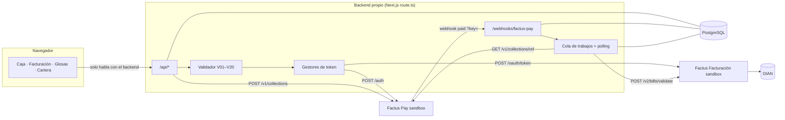

# SaludFactura

**Problema.** En las IPS el cobro en caja y la factura viven en sistemas distintos: copagos cobrados y no facturados, copagos que no se descuentan en la factura a la EPS y facturas mal armadas que terminan en glosas.
**Solución.** El copago se cobra con **Factus Pay** (QR Bre-B) y el pago confirmado dispara la factura **SS-Recaudo** en **Factus Facturación**. Al cerrar la atención se emite la **SS-CUFE** a la EPS descontando lo recaudado; si la EPS glosa, sale la **nota crédito**.
**Diferenciador.** Un motor de validación previa (reglas V01–V20) bloquea la factura mal armada antes de llegar a la DIAN.

> Demo desplegada: `https://<completar>` · Video (2–3 min): `<completar>`

## Integrantes

| Integrante | Parte | Rol |
|---|---|---|
| _(nombre)_ | 1 | Integración Factus Pay |
| _(nombre)_ | 2 | Integración Factus Facturación |
| _(nombre)_ | 3 | Backend, datos y validador |
| _(nombre)_ | 4 | Frontend |
| _(nombre)_ | 5 | Despliegue, video y pitch |

## Arquitectura



El frontend nunca ve un token ni llama a Factus. Las credenciales viven solo en variables de entorno del servidor. Detalle del flujo, estados y manejo de errores en [`docs/integracion.md`](docs/integracion.md).

## Cómo correrlo

Requisitos: Node 20+, una base PostgreSQL (Supabase sirve) y las credenciales sandbox de Factus.

```bash
npm install
cp .env.example .env          # completa los valores; .env está en .gitignore
npm run db:migrar             # o pega db/schema.sql y db/seed.sql en el SQL Editor de Supabase
npm run dev                   # http://localhost:3000
npm test                      # 38 pruebas: validador, builders y clientes contra servidores falsos de Factus
```

**En los portátiles del equipo deja `FACTUS_PAY_MOCK=true`.** Factus Pay permite un solo token activo por usuario: si un portátil llama a `/auth`, revoca el token del servidor desplegado y la demo empieza a fallar con 401. En modo simulado la pantalla de caja muestra botones "Simular pago exitoso / fallido". Con `FACTUS_MOCK=true` también se simula Facturación, solo para maquetar pantallas sin credenciales.

## Reparto del trabajo (dónde está cada parte)

| Parte | Archivos | Lo que falta hacer en el evento |
|---|---|---|
| **1 · Factus Pay** | `lib/factus/payAuth.ts`, `payClient.ts`, `payMock.ts` · `lib/services/cobros.ts`, `webhook.ts` · `app/webhooks/factus-pay/route.ts` · `app/api/admisiones/[id]/cobro/route.ts` | Probar contra el sandbox real desde el despliegue; confirmar el formato de `qr_expires_at` y si `/auth` pide `X-Factus-Access-Key` |
| **2 · Factus Facturación** | `lib/factus/factusAuth.ts`, `factusClient.ts`, `factusMock.ts` · `lib/builders/*` · `lib/services/facturas.ts` · `app/api/facturas/[id]/{pdf,xml}` | Poner los IDs de rango (salen en `/api/salud`); probar SS-Recaudo y SS-CUFE reales; confirmar la pregunta abierta del monto en `payment_details` (variable `SS_CUFE_PAGO_DESCUENTA_PREPAGOS`) |
| **3 · Backend y datos** | `db/schema.sql`, `db/seed.sql` · `lib/db.ts` · `lib/validation/*` · `lib/services/{admisiones,jobs,glosas,cartera,salud,worker}.ts` · `app/api/**` | Ajustar datos de prueba; nota crédito contra el sandbox real (módulo de menor prioridad) |
| **4 · Frontend** | `app/page.tsx` (salud), `app/caja`, `app/facturacion`, `app/glosas`, `app/cartera`, `app/components`, `app/globals.css` | Pulir pantallas para el pitch |
| **5 · Despliegue y entrega** | `README.md`, `.env.example`, `docs/integracion.md` | Desplegar temprano, registrar el webhook, video y ensayo del pitch |

## Despliegue (HTTPS para el webhook)

**Vercel** (lo que ya conocemos):
1. Supabase → Project Settings → Database → copiar la *Connection string* del **Transaction pooler** (puerto 6543) a `DATABASE_URL`. Correr `db/schema.sql` y `db/seed.sql` en el SQL Editor.
2. Importar el repo en Vercel y cargar las variables de `.env.example` en Settings → Environment Variables, con `FACTUS_MOCK=false`, `FACTUS_PAY_MOCK=false` y `APP_PUBLIC_URL=https://<proyecto>.vercel.app`.
3. Desplegar y abrir `https://<app>/`: la página muestra `/api/salud`. Copiar el ID del rango de facturas a `FACTUS_NUMBERING_RANGE_ID` (y el de notas crédito) y volver a desplegar.
4. En el panel de Factus Pay → Webhook: URL `https://<app>/webhooks/factus-pay` y la llave `FACTUS_PAY_WEBHOOK_KEY`.
5. Crear un cobro en Caja, pagarlo en el [simulador](https://pay-api-sandbox.factus.com.co/simulator) y ver salir la factura.
6. Polling de respaldo: la pantalla de caja reconcilia sola cada pocos segundos. Para tenerlo también sin pantalla abierta, crear en cron-job.org una tarea cada minuto a `https://<app>/api/cron/tick` con el encabezado `Authorization: Bearer <CRON_SECRET>`.

**Railway / Render** (proceso persistente, como sugiere la especificación): `npm run build` y `npm start`, con `RUN_WORKER=true` para que la cola y el polling cada 30 s corran en el mismo proceso.

Congelar el despliegue 30 minutos antes del pitch.

## Endpoints de Factus usados

| API | Endpoint | Para qué |
|---|---|---|
| Facturación | `POST /oauth/token` | Token OAuth2 (password grant y refresh antes de la hora) |
| Facturación | `POST /v2/bills/validate` | Factura SS-Recaudo (copago) y SS-CUFE (EPS) |
| Facturación | `GET /v2/bills?filter[reference_code]=` · `GET /v2/bills/:number` | Consulta por referencia ante un 409 |
| Facturación | `DELETE /v2/bills/destroy/reference/:reference_code` | Eliminar la no validada y reenviar (409) |
| Facturación | `GET /v2/bills/:number/download-pdf` · `/download-xml/` | PDF y XML en la demo |
| Facturación | `POST /v2/credit-notes/validate` | Nota crédito por glosa aceptada |
| Facturación | `GET /v2/numbering-ranges` | Rangos activos (en `/api/salud`) |
| Factus Pay | `POST /auth` | Token Bearer (uno por usuario) |
| Factus Pay | `POST /v1/collections` | Crear el recaudo y su QR Bre-B |
| Factus Pay | `GET /v1/collections/:reference_code` | Polling y confirmación antes de facturar |
| Factus Pay | Webhook `POST /webhooks/factus-pay?key=` | Aviso de recaudo pagado |

## Endpoints internos

`POST /api/admisiones` · `GET /api/admisiones/:id` · `POST /api/admisiones/:id/cobro` · `POST /webhooks/factus-pay` · `POST /api/atenciones/:id/factura-eps` · `POST /api/validaciones` · `GET /api/facturas` · `GET /api/facturas/:id/{pdf,xml}` · `POST /api/glosas` · `POST /api/glosas/:id/{aceptar,rechazar}` · `GET /api/notas-credito/:id/{pdf,xml}` · `GET /api/cartera` · `GET /api/salud` · `GET /api/cron/tick`

## Seguridad de llaves

- `.env` en `.gitignore` desde el primer commit; `.env.example` solo con nombres.
- El logger filtra `Authorization`, `client_secret`, `password`, tokens y el parámetro `key` del webhook. El registro de peticiones de la plataforma (Vercel) puede mostrar la URL completa: no compartan capturas de esos logs.
- La llave del webhook se compara en tiempo constante (`crypto.timingSafeEqual`).
- Los datos del pagador que llegan por webhook se guardan con el documento enmascarado; el QR no se guarda en la auditoría.
- RLS activado en todas las tablas (Supabase no las expone por su API pública).
- Antes de publicar: `git log -p | grep -iE "secret|password|token"` o `gitleaks detect`.

## Declaración

Solo se usan APIs de Factus (sin pasarelas externas), solo en ambiente **Sandbox** (sin dinero real), y el código se desarrolló durante el evento. Los pacientes, EPS, tarifas y cuotas son ficticios.
