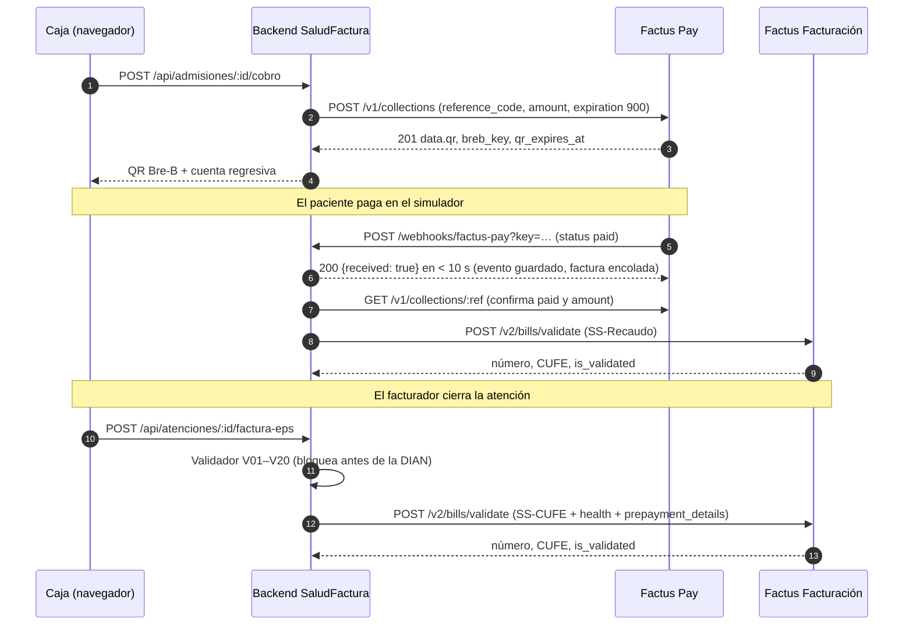
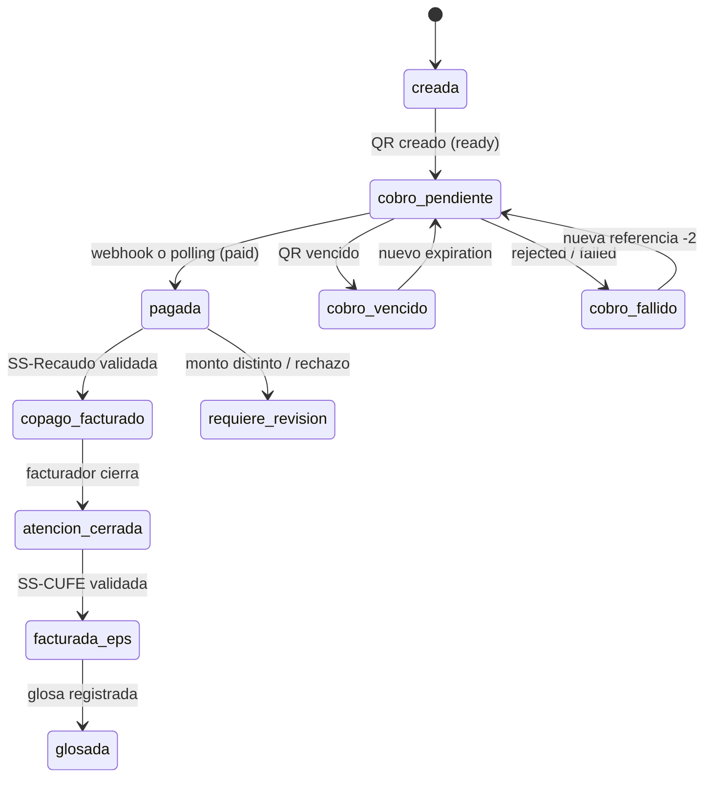

# Integración con Factus Pay y Factus Facturación

Una atención genera dos facturas trazadas por la misma admisión: la del copago al paciente (**SS-Recaudo**, se emite sola cuando Factus Pay confirma el pago) y la del saldo a la EPS (**SS-CUFE**, con el copago en `prepayment_details`). El webhook de pago es el disparador que une las dos APIs.

## Secuencia de una atención

Si el webhook no llega, el **polling** (`GET /v1/collections/:ref`) detecta el pago: la pantalla de caja reconcilia cada pocos segundos, el worker cada 30 s (Railway) y `/api/cron/tick` desde un cron externo (Vercel). Factus Pay no avisa los pagos fallidos; también se detectan por polling y no generan factura.

## Autenticación

| | Factus Facturación | Factus Pay |
|---|---|---|
| Endpoint | `POST /oauth/token` (form-urlencoded) | `POST /auth` (JSON) |
| Vigencia | 3600 s | Sin vencimiento, pero cada `/auth` revoca el anterior |
| Gestor | `FactusAuthManager`: renueva con refresh 5 min antes; si falla, password grant; ante 401 renueva una vez | `FactusPayAuth`: se autentica una vez; ante 401 reautentica solo si nadie más lo hizo ya |
| Concurrencia | Candado local + `pg_advisory_xact_lock` | Igual; el token se guarda en `api_tokens` para que todas las instancias usen el mismo |

## Estados de la admisión

Ningún estado salta pasos: no hay SS-CUFE si la SS-Recaudo de su copago no está validada (reglas V15 y V16).

## Referencias e idempotencia

| Documento | reference_code | Ejemplo |
|---|---|---|
| Recaudo Factus Pay | `ADM-<año>-<admisión>-<concepto>` | `ADM-2026-000123-CUO` |
| Factura SS-Recaudo | `FV-` + referencia del recaudo | `FV-ADM-2026-000123-CUO` |
| Factura SS-CUFE | `FV-ATN-<año>-<atención>-EPS` | `FV-ATN-2026-000123-EPS` |
| Nota crédito | `NC-` + factura + consecutivo | `NC-FV-ATN-2026-000123-EPS-01` |

Cada `reference_code` tiene índice único en PostgreSQL y las dos APIs son idempotentes por referencia: un webhook repetido, un doble clic o un reintento no crean duplicados. La cola (`jobs`) tiene llave única `(tipo, clave)`.

## Manejo de errores

| API | Código | Respuesta del sistema |
|---|---|---|
| Facturación | 401 | Renueva el token una vez y reintenta |
| Facturación | 409 | Consulta por referencia; si `is_validated` es true toma esa factura; si no, `DELETE` por referencia, espera 1 s y reenvía una sola vez; si vuelve el 409, `requiere_revision` |
| Facturación | 400 / 422 | No reintenta; guarda el mensaje y lo muestra en el panel |
| Facturación | 5xx / timeout | Reintenta a los 2, 4 y 8 s; la cola reintenta después con espera creciente |
| Pay | 401 | Reautentica una vez (token revocado por otro `/auth`) |
| Pay | 404 | Marca el recaudo para revisión; no reintenta |
| Pay | 422 | No reintenta (V01/V02 debieron atraparlo) |
| Pay | 429 | No vuelve a llamar a `/auth` durante 60 s |
| Webhook | llave inválida | 401 y no procesa |
| Webhook | monto distinto / referencia desconocida | Guarda el evento, marca revisión manual y responde 200 |

## Motor de validación previa (V01–V20)

Funciones puras `regla(payload, contexto) → hallazgos` en `lib/validation/reglas.ts`, agrupadas por documento (`recaudoPay`, `ssRecaudo`, `ssCufe`, `notaCredito`). Los errores bloquean el envío y quedan guardados en `facturas.errores_validacion`; las advertencias (V17, tarifa distinta a la pactada) dejan pasar. `POST /api/validaciones` corre el validador sin enviar, para que el facturador vea los errores antes de emitir.

## Pendiente de confirmar en el sandbox

- Monto exacto de `payment_details` en la SS-CUFE frente a `prepayment_details` (variable `SS_CUFE_PAGO_DESCUENTA_PREPAGOS`).
- `concept_code` del copago (se usa la tabla de Factus: 01 copago, 02 cuota moderadora, 03 pagos compartidos).
- Si la nota crédito sobre una SS-CUFE debe llevar el objeto `health` y qué `customization_id` usa.
- Si las credenciales de Factus Pay son las mismas del sandbox de facturación.
